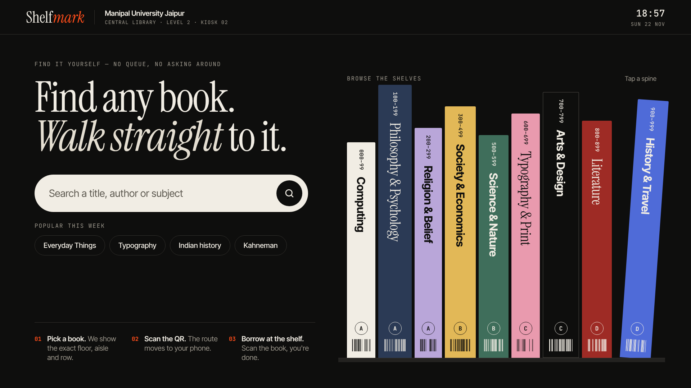
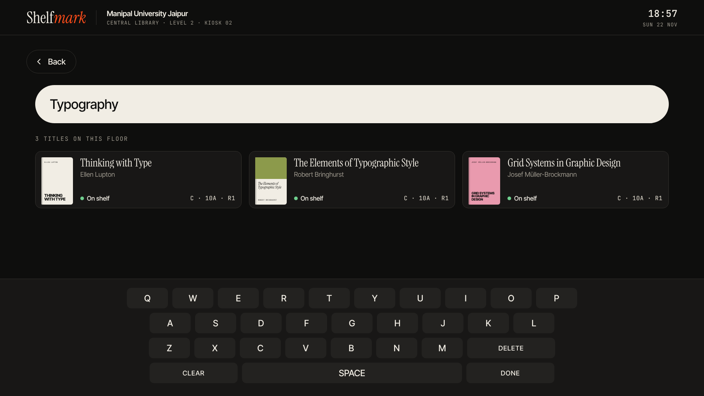
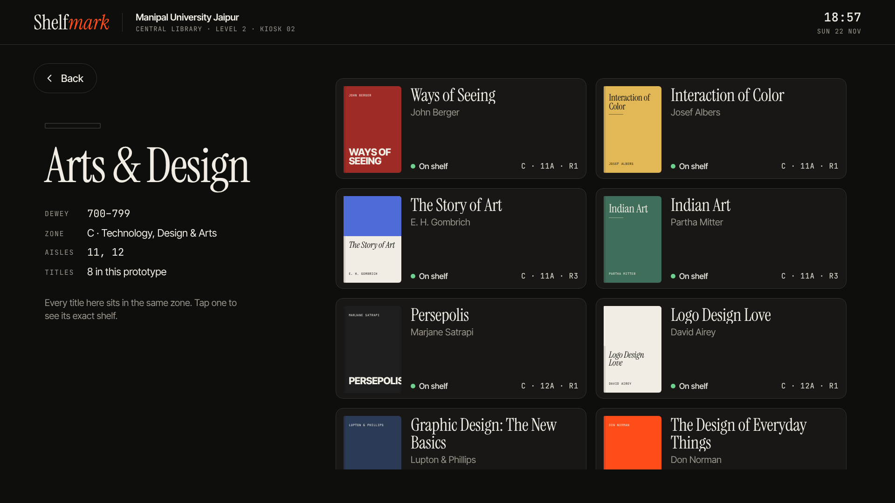
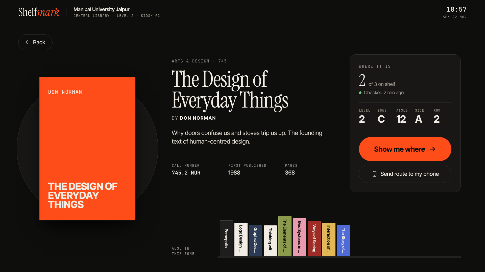
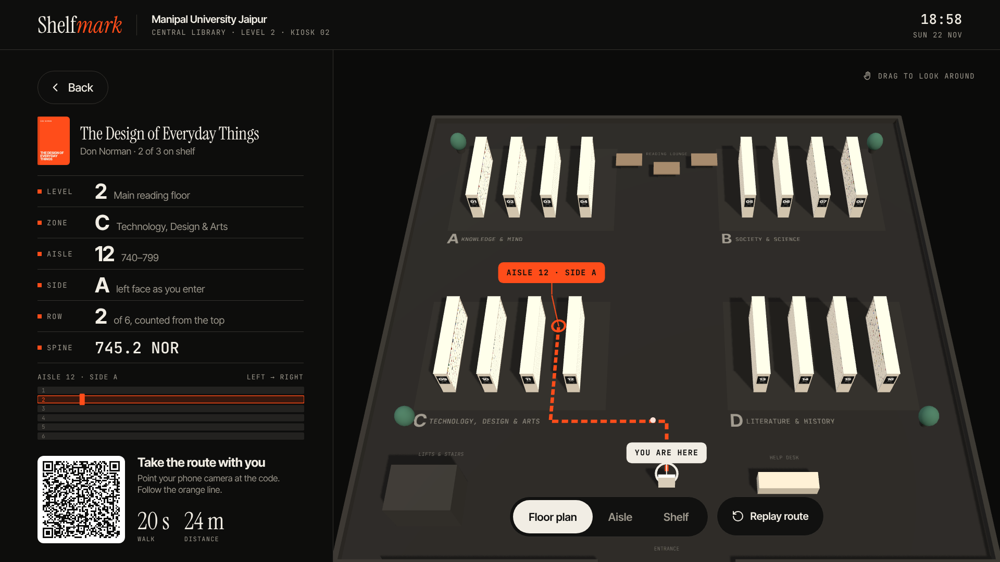
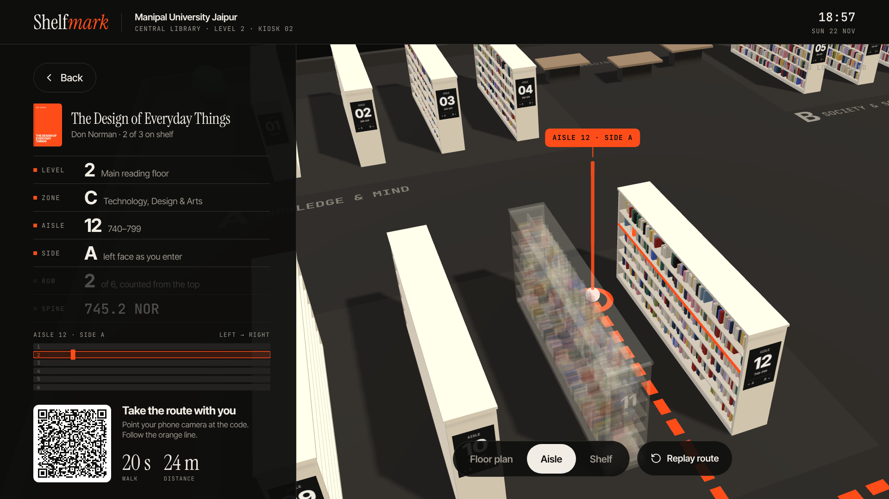
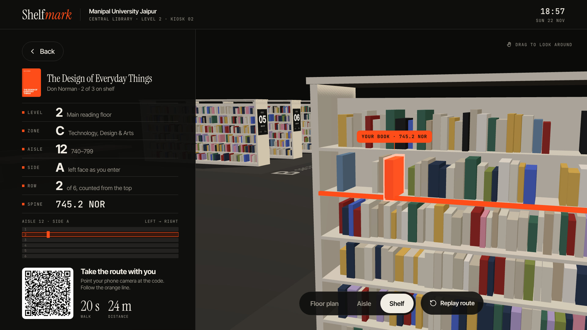

# Shelfmark — Library Kiosk

**Find any book. Walk straight to it.**

Shelfmark is an interactive kiosk interface for a university library. You pick a book, and the kiosk shows exactly where it is: floor, zone, aisle, shelf side, row and spine label. It shows all of this on a live 3D model of the library. Scan a QR code and the route goes to your phone, so you can walk to the shelf and borrow the book there. No searching, no queue at the help desk.

This is a working design prototype for **Manipal University Jaipur — Central Library** (the layout and catalogue are illustrative).



---

## Contents

- [The problem](#the-problem)
- [How it works](#how-it-works)
- [Screens](#screens)
- [Tech stack](#tech-stack)
- [Getting started](#getting-started)
- [Project structure](#project-structure)
- [The location model](#the-location-model)
- [Customising](#customising)
- [Design system](#design-system)
- [Running it as a real kiosk](#running-it-as-a-real-kiosk)
- [Roadmap](#roadmap)
- [Credits](#credits)

---

## The problem

Most library kiosks are good at **discovery**: they recommend books and show lists. They stop at a call number like `720.95957 SAA`. The reader then has to decode it, find the floor, find the right aisle and scan spines one by one, or ask someone.

Shelfmark covers that missing second half: **getting from the screen to the shelf**.

## How it works

```
Pick a book  →  See where it is (3D)  →  Scan the QR  →  Follow the route  →  Borrow at the shelf
```

1. **Find:** search with the on-screen keyboard, tap a popular search, or browse categories shown as book spines.
2. **Check:** the book page shows live availability ("2 of 3 on shelf") and the location chain before anyone walks anywhere. If every copy is out, it offers *Reserve* instead.
3. **Locate:** the 3D viewer plays a guided fly-through:
   - **Floor plan:** an overview of the floor; an orange route draws from *You are here* to the aisle.
   - **Aisle:** the camera flies into the aisle, and the shelf unit in front turns see-through so it doesn't block the view.
   - **Shelf:** the camera faces the shelf; the row lights up and the book slides out.

   The side panel lights up each step of the location in sync with the camera.
4. **Take it with you:** the QR code carries the route to the reader's phone. The phone companion is the next milestone; right now the QR holds the route as text.

## Screens

| Home | Search |
|---|---|
|  |  |
| **Category** | **Book detail** |
|  |  |
| **3D: floor plan** | **3D: aisle** |
|  |  |
| **3D: shelf** | |
|  | |

## Tech stack

| Layer | Choice | Why |
|---|---|---|
| Build tool | **[Vite](https://vite.dev)** | Instant dev server, one-command production build, no framework lock-in. |
| Language | **Vanilla JavaScript (ES modules)** | Five screens and one 3D scene don't need a framework. Each screen is a small module. |
| 3D | **[three.js](https://threejs.org)** | WebGL rendering of the floor, 16 shelf units and ~13,000 books (one `InstancedMesh` per unit, so 16 draw calls). |
| QR codes | **[qrcode-generator](https://www.npmjs.com/package/qrcode-generator)** | Small, dependency-free, renders to crisp SVG. |
| Fonts | **[Fontsource](https://fontsource.org)**: Instrument Serif, Inter Tight, JetBrains Mono | Self-hosted, so the kiosk works offline. All three are under the SIL Open Font License. |
| Styling | **Plain CSS** with custom properties | One file per screen; every colour and font comes from `tokens.css`. |

There is no backend. The catalogue is a JSON file and everything runs in the browser.

## Getting started

You need **Node.js 20.19+ or 22.12+**.

```bash
npm install        # install dependencies
npm run dev        # start the dev server → http://localhost:5173
npm run build      # production build → dist/
npm run preview    # serve the production build → http://localhost:4173
```

The interface is designed on a **1920 × 1080** landscape canvas and scales to fit any window. Press **F11** (fullscreen) to see it the way a kiosk would.

Tips while testing on a laptop:
- You can type on your physical keyboard on the Search screen.
- Scroll the mouse wheel to zoom in the 3D view, and drag to look around.
- The browser console exposes `window.shelfmark` (e.g. `shelfmark.openBook(22)`).

> `dist/` must be served over http (`npm run preview`, or any static host). Opening `dist/index.html` straight from the file system won't work, because browsers block ES modules on `file://`.

## Project structure

```
shelfmark-kiosk/
├── index.html                 # Markup for the stage, top bar and all five screens
├── package.json
├── vite.config.js
├── docs/screens/              # Screenshots used in this README
└── src/
    ├── main.js                # Entry point: loads fonts + styles, starts every screen
    ├── config.js              # Library name, idle timeout, walking speed, accent colour…
    │
    ├── data/
    │   ├── books.json         # The catalogue (title, author, Dewey, copies, cover colour…)
    │   ├── categories.js      # Browsing categories = the spines on the home screen
    │   └── layout.js          # Floor plan: zones, shelf units, Dewey range per aisle
    │
    ├── lib/                   # Logic with no UI
    │   ├── catalogue.js       # Loads books and works out each book's exact location
    │   ├── search.js          # Ranked search over title, author, subject, call number
    │   ├── qr.js              # Text → SVG QR code
    │   └── util.js            # DOM helpers, colour contrast, seeded random
    │
    ├── app/                   # The app shell
    │   ├── router.js          # Screen switching, back stack, enter/leave hooks
    │   ├── stage.js           # Scales the 1920×1080 stage to any screen
    │   └── chrome.js          # Top bar, clock, toast messages, idle reset
    │
    ├── ui/
    │   └── components.js      # Generated covers, result cards, availability, barcodes
    │
    ├── screens/               # One module per screen
    │   ├── home.js
    │   ├── search.js
    │   ├── category.js
    │   ├── book.js
    │   └── locate.js          # Side panel + hooks up the 3D scene
    │
    ├── three/                 # The 3D library
    │   ├── LibraryScene.js    # Puts it all together + runs the guided fly-through
    │   ├── environment.js     # Lights, floor, zones, walls, furniture, kiosk
    │   ├── shelves.js         # Shelf units, aisle signs, instanced books, see-through fade
    │   ├── route.js           # Orange dashed route + the walking dot
    │   ├── highlight.js       # Glowing book, row strip, beam, floor ring
    │   ├── cameraRig.js       # Orbit camera with eased moves between views
    │   └── materials.js       # Colours, materials, canvas-text textures
    │
    └── styles/
        ├── index.css          # Imports everything below, in order
        ├── tokens.css         # Design tokens: colours + font families
        ├── base.css           # Reset + fixed stage
        ├── topbar.css · screens.css · components.css · cover.css
        └── home.css · search.css · category.css · book.css · locate.css
```

## The location model

Every book's location is one chain:

```
Level → Zone → Aisle → Side → Row → Call number
  2       C      12      A      2     745.2 NOR
```

- **Zones** (`data/layout.js`): four areas in a 2 × 2 grid, A–D.
- **Aisles**: 16 double-sided shelf units, numbered 01–16. Each one holds a Dewey range (aisle 12 = 740–799). The number and range are printed on a sign at both ends of every unit, in the 3D model and, in a real deployment, on the physical shelves.
- **Sides**: **A** is the left face as you walk in, **B** the right.
- **Rows**: 1–6, **counted from the top**.

`lib/catalogue.js` places each book automatically from its Dewey number. An aisle's range is spread across its 12 shelves (side A rows 1–6, then side B rows 1–6), read left to right. Change a book's `dewey` in `books.json` and it moves on its own.

> In a real library, location would come from the library management system (Koha, OPAC, or RFID shelf data). That would also make availability live and avoid relying on calculated positions. Only `lib/catalogue.js` would need to change.

## Customising

| To change… | Edit |
|---|---|
| Library name, building, level, kiosk ID | `src/config.js` → `library` |
| Idle reset time, walking speed, popular searches | `src/config.js` |
| Books | `src/data/books.json` (see fields below) |
| Categories on the home screen | `src/data/categories.js` |
| Zones, aisles and their Dewey ranges | `src/data/layout.js` |
| Colours and fonts | `src/styles/tokens.css` (and `src/three/materials.js` for the 3D scene) |
| Camera angles for floor / aisle / shelf | `presets()` in `src/three/LibraryScene.js` |

**Book record** (`books.json`):

```json
{
  "id": 22,
  "title": "The Design of Everyday Things",
  "author": "Don Norman",
  "year": 1988,
  "dewey": 745.2,
  "cutter": "NOR",
  "pages": 368,
  "coverColor": "#FF4D1A",
  "coverStyle": 1,
  "copies": 3,
  "available": 2,
  "nextDue": null,
  "summary": "Why doors confuse us and stoves trip us up…"
}
```

`coverStyle` is `0`, `1` or `2`: three typographic cover layouts generated in code. No real cover art is used. Set `available` to `0` and `nextDue` to a date to see the "all copies borrowed" flow.

## Design system

The visual language comes from **book spines**: the home screen navigation is a shelf of category spines with vertical type, Dewey ranges and barcodes.

- **Ground:** near-black ink `#0E0E0D` with warm paper text `#F1EDE4`. The whole kiosk is dark mode.
- **One accent:** signal orange `#FF4D1A`, used **only** for "your book is here": the route, the highlighted row, the book, the main button. When orange appears, it means location.
- **Type:**
  - *Instrument Serif* for titles and headlines (editorial)
  - *Inter Tight* for interface text and big numbers
  - *JetBrains Mono* for call numbers, labels and aisle signs, matching shelf labelling
- **Kiosk ergonomics:** reading text 18 px or larger on a 1080p screen (small mono labels 13–16 px), touch targets at least 56 px, main actions in the lower half, and idle reset to home after 2 minutes.

## Running it as a real kiosk

1. `npm run build` and host `dist/` on any static server (or a local one on the kiosk PC).
2. Launch Chrome in kiosk mode on a 1920 × 1080 touchscreen:
   ```bash
   chrome --kiosk --app=http://localhost:4173 --disable-pinch --overscroll-history-navigation=0
   ```
3. The 3D view uses WebGL. Any integrated GPU from the last ~8 years handles it. If WebGL is unavailable, the kiosk shows the full text location instead of the 3D view.

## Roadmap

- [ ] **Phone companion:** QR opens a mobile page with step-by-step directions, a flat shelf view and live progress.
- [ ] **Borrow at the shelf:** scan the book's barcode on the phone, confirm with the library card, get a digital due-date slip.
- [ ] **"Not here?" flow:** report a missing or misplaced book, then see the nearest other copy or reserve one.
- [ ] **Multi-book routes:** collect several books in one walk.
- [ ] **Live data:** connect to the library system for real availability and positions.
- [ ] **Hindi language toggle** and accessibility mode (lower layout, larger text, top-shelf assistance).
- [ ] **Multiple floors** with lift and stair transitions in 3D.

## Credits
- Book titles, authors and dates are real works, used to make the catalogue believable. Summaries are original. Covers are generated typographic designs, not reproductions.
- Fonts: Instrument Serif, Inter Tight, JetBrains Mono (SIL Open Font License), via Fontsource.
- three.js (MIT), qrcode-generator (MIT), Vite (MIT).
